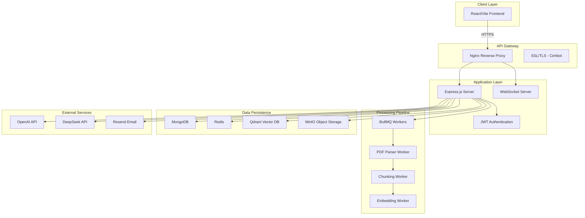
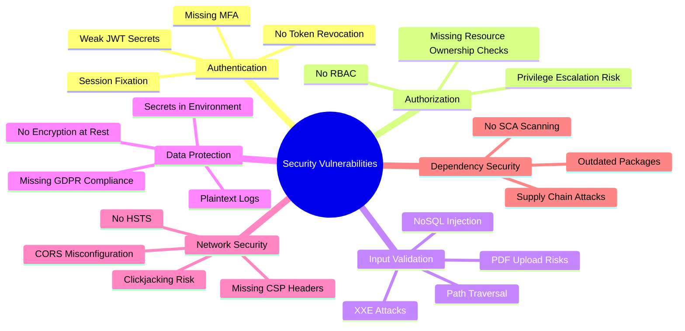

# LUNAI Technical Analysis: Architecture Assessment & Security Audit

I'll provide a comprehensive analysis of your RAG-based research paper platform, examining architectural decisions, implementation quality, and security vulnerabilities with detailed remediation strategies.

## System Architecture Overview



## Architectural Strengths & Deficiencies

### 1. **Service Orchestration Architecture**

#### ✅ Strengths

**Microservices-Adjacent Design with Appropriate Complexity**
```typescript
// Well-separated concerns
- PDF Processing Service
- Embedding Service  
- Vector Service
- RAG Service
- Token Management Service
```

The stratification demonstrates commendable separation of concerns without over-engineering into full microservices prematurely.

**Asynchronous Processing Pipeline**
```typescript
// Excellent use of BullMQ for background jobs
PDF Upload → Parsing → Chunking → Embedding → Ready
```

This prevents request blocking and provides graceful degradation.

#### ❌ Deficiencies

**Tight Coupling Between Services**
```typescript
// Current implementation in rag.service.ts
import { embeddingService } from './embedding.service.js';
import { vectorService } from './vector.service.js';
import { llmService } from './llm/llm.service.js';
```

**Recommended Solution:**
```typescript
// Implement Dependency Injection with Inversify
import { injectable, inject } from 'inversify';
import { TYPES } from '../types';

@injectable()
class RagService {
  constructor(
    @inject(TYPES.EmbeddingService) private embeddingService: IEmbeddingService,
    @inject(TYPES.VectorService) private vectorService: IVectorService,
    @inject(TYPES.LLMService) private llmService: ILLMService
  ) {}
}

// types.ts
export const TYPES = {
  EmbeddingService: Symbol.for('EmbeddingService'),
  VectorService: Symbol.for('VectorService'),
  LLMService: Symbol.for('LLMService'),
};
```

### 2. **Data Persistence Layer**

#### ✅ Strengths

**Polyglot Persistence Strategy**
- MongoDB: Document storage (papers, users, conversations)
- Redis: Caching & job queue
- Qdrant: Vector similarity search
- MinIO: Object storage

This is architecturally sound and demonstrates understanding of specialized data stores.

**Hierarchical Chunking Strategy**
```typescript
// chunking.service.ts - Excellent implementation
async createHierarchicalChunks(
  fullText: string,
  sections: Section[]
): Promise<ChunkResult[]>
```

#### ❌ Deficiencies

**Absence of Database Connection Pooling Configuration**
```typescript
// database.ts - Missing pool configuration
await mongoose.connect(env.MONGODB_URI);
```

**Recommended Solution:**
```typescript
import mongoose from 'mongoose';
import { env } from './env.js';

const mongooseOptions = {
  maxPoolSize: 10,
  minPoolSize: 5,
  socketTimeoutMS: 45000,
  serverSelectionTimeoutMS: 5000,
  heartbeatFrequencyMS: 10000,
  // Connection retry strategy
  retryWrites: true,
  retryReads: true,
  // Read/Write concern
  writeConcern: {
    w: 'majority',
    wtimeout: 5000,
  },
  readPreference: 'primaryPreferred',
};

export async function connectDatabase(): Promise<void> {
  try {
    await mongoose.connect(env.MONGODB_URI, mongooseOptions);
    
    // Connection event handlers
    mongoose.connection.on('connected', () => {
      console.log('✅ MongoDB connected with pool:', {
        maxPoolSize: mongooseOptions.maxPoolSize,
        minPoolSize: mongooseOptions.minPoolSize,
      });
    });
    
    mongoose.connection.on('error', (error) => {
      console.error('❌ MongoDB connection error:', error);
      // Implement circuit breaker pattern
      handleDatabaseCircuitBreaker(error);
    });
    
  } catch (error) {
    console.error('❌ Failed to connect to MongoDB:', error);
    process.exit(1);
  }
}
```

**Missing Transaction Support for Critical Operations**
```typescript
// paper.controller.ts - Delete operation lacks atomicity
async delete(req: AuthRequest, res: Response, next: NextFunction): Promise<void> {
  // Multiple operations without transaction
  await minioService.deleteFile(paper.fileUrl);
  await vectorService.deleteByPaperId(paper._id.toString());
  await Chunk.deleteMany({ paperId: paper._id });
  await Conversation.deleteMany({ paperId: paper._id });
  await paper.deleteOne();
}
```

**Recommended Solution:**
```typescript
async delete(req: AuthRequest, res: Response, next: NextFunction): Promise<void> {
  const session = await mongoose.startSession();
  
  try {
    await session.withTransaction(async () => {
      const paper = await Paper.findById(req.params.id).session(session);
      
      if (!paper) {
        throw new NotFoundError('Paper not found');
      }
      
      if (paper.userId.toString() !== req.userId) {
        throw new ForbiddenError('Access denied');
      }
      
      // All operations within transaction
      await Chunk.deleteMany({ paperId: paper._id }).session(session);
      await Conversation.deleteMany({ paperId: paper._id }).session(session);
      await paper.deleteOne({ session });
      
      // External services deleted after DB operations succeed
      await Promise.all([
        minioService.deleteFile(paper.fileUrl),
        vectorService.deleteByPaperId(paper._id.toString()),
      ]);
    });
    
    res.json({
      status: 'success',
      message: 'Paper deleted successfully',
    });
  } catch (error) {
    next(error);
  } finally {
    await session.endSession();
  }
}
```

### 3. **Authentication & Authorization**

#### ✅ Strengths

**JWT-based Authentication with Refresh Tokens**
```typescript
// Proper separation of access/refresh tokens
export function generateTokens(userId: string): {
  accessToken: string;
  refreshToken: string;
}
```

#### ❌ Critical Deficiencies

**JWT Secret Validation Insufficient**
```typescript
// env.ts - JWT_SECRET can be weak
JWT_SECRET: z.string(),
```

**Recommended Solution:**
```typescript
// env.ts - Enforce strong secrets in production
const envSchema = z.object({
  JWT_SECRET: z.string().min(32).refine(
    (val) => env.NODE_ENV === 'development' || val.length >= 64,
    { message: 'JWT_SECRET must be at least 64 characters in production' }
  ),
  JWT_REFRESH_SECRET: z.string().min(32).refine(
    (val) => env.NODE_ENV === 'development' || val.length >= 64,
    { message: 'JWT_REFRESH_SECRET must be at least 64 characters in production' }
  ),
});
```

**No Token Revocation Mechanism**

**Recommended Solution:**
```typescript
// services/token-blacklist.service.ts
import { redis } from '../config/redis.js';

class TokenBlacklistService {
  private readonly PREFIX = 'blacklist:token:';
  
  async revokeToken(token: string, expiresIn: number): Promise<void> {
    await redis.setex(
      `${this.PREFIX}${token}`,
      expiresIn,
      '1'
    );
  }
  
  async isRevoked(token: string): Promise<boolean> {
    const result = await redis.get(`${this.PREFIX}${token}`);
    return result === '1';
  }
}

export const tokenBlacklistService = new TokenBlacklistService();

// middleware/auth.ts - Add revocation check
export function authenticate(
  req: AuthRequest,
  _res: Response,
  next: NextFunction
): void {
  try {
    const token = extractToken(req);
    const decoded = jwt.verify(token, env.JWT_SECRET) as JwtPayload;
    
    // Check if token is blacklisted
    const isRevoked = await tokenBlacklistService.isRevoked(token);
    if (isRevoked) {
      throw new UnauthorizedError('Token has been revoked');
    }
    
    req.userId = decoded.userId;
    next();
  } catch (error) {
    next(error);
  }
}
```

**Missing Rate Limiting**

**Recommended Solution:**
```typescript
// middleware/rate-limit.ts
import rateLimit from 'express-rate-limit';
import RedisStore from 'rate-limit-redis';
import { redis } from '../config/redis.js';

export const authRateLimiter = rateLimit({
  store: new RedisStore({
    client: redis,
    prefix: 'rl:auth:',
  }),
  windowMs: 15 * 60 * 1000, // 15 minutes
  max: 5, // 5 requests per window
  message: 'Too many authentication attempts, please try again later',
  standardHeaders: true,
  legacyHeaders: false,
});

export const apiRateLimiter = rateLimit({
  store: new RedisStore({
    client: redis,
    prefix: 'rl:api:',
  }),
  windowMs: 60 * 1000, // 1 minute
  max: 100, // 100 requests per minute
  keyGenerator: (req) => req.userId || req.ip,
});

// index.ts
app.use('/api/auth', authRateLimiter);
app.use('/api', authenticate, apiRateLimiter);
```

### 4. **Token Management System**

#### ✅ Strengths

**Sophisticated Token Accounting**
```typescript
// Token usage tracking with allowances
interface ITokenUsage {
  used: number;
  allowance: number;
  lastResetAt: Date;
  pendingRequest: boolean;
}
```

#### ❌ Deficiencies

**Imprecise Token Estimation**
```typescript
// rag.service.ts - Crude estimation
private estimateTokens(text: string, maxResponseTokens: number): number {
  const inputTokens = Math.ceil(text.length / 4);
  return inputTokens + maxResponseTokens;
}
```

**Recommended Solution:**
```typescript
// services/token-counter.service.ts
import { get_encoding, encoding_for_model } from 'tiktoken';

class TokenCounterService {
  private encodingCache = new Map<string, ReturnType<typeof get_encoding>>();
  
  getEncoding(model: string = 'gpt-4'): ReturnType<typeof get_encoding> {
    if (!this.encodingCache.has(model)) {
      this.encodingCache.set(model, encoding_for_model(model as any));
    }
    return this.encodingCache.get(model)!;
  }
  
  countTokens(text: string, model: string = 'gpt-4'): number {
    const encoding = this.getEncoding(model);
    return encoding.encode(text).length;
  }
  
  countMessagesTokens(
    messages: Array<{ role: string; content: string }>,
    model: string = 'gpt-4'
  ): number {
    const encoding = this.getEncoding(model);
    let tokenCount = 0;
    
    for (const message of messages) {
      // Model-specific token counting
      tokenCount += 4; // Every message has metadata tokens
      tokenCount += encoding.encode(message.content).length;
      tokenCount += encoding.encode(message.role).length;
    }
    
    tokenCount += 2; // Every request has priming tokens
    
    return tokenCount;
  }
  
  estimateResponseTokens(
    maxTokens: number,
    temperatureVariance: number = 0.1
  ): number {
    // Add variance for temperature unpredictability
    return Math.ceil(maxTokens * (1 + temperatureVariance));
  }
}

export const tokenCounterService = new TokenCounterService();
```

**Race Condition in Token Deduction**
```typescript
// token.service.ts - Non-atomic update
async recordUsage(userId: string, tokensUsed: number): Promise<TokenUsageInfo> {
  const user = await User.findByIdAndUpdate(
    userId,
    { $inc: { 'tokenUsage.used': tokensUsed } },
    { new: true }
  );
}
```

**Recommended Solution:**
```typescript
// Implement optimistic locking
const userSchema = new Schema({
  // ... existing fields
  tokenUsage: {
    used: Number,
    allowance: Number,
    version: { type: Number, default: 0 },
  },
});

async recordUsage(userId: string, tokensUsed: number): Promise<TokenUsageInfo> {
  const MAX_RETRIES = 3;
  let retries = 0;
  
  while (retries < MAX_RETRIES) {
    const user = await User.findById(userId).select('tokenUsage').lean();
    
    if (!user) {
      throw new Error('User not found');
    }
    
    const newUsed = (user.tokenUsage?.used || 0) + tokensUsed;
    const currentVersion = user.tokenUsage?.version || 0;
    
    // Atomic update with version check
    const result = await User.findOneAndUpdate(
      {
        _id: userId,
        'tokenUsage.version': currentVersion,
      },
      {
        $set: { 'tokenUsage.used': newUsed },
        $inc: { 'tokenUsage.version': 1 },
      },
      { new: true }
    ).select('tokenUsage').lean();
    
    if (result) {
      return this.buildUsageInfo(result);
    }
    
    retries++;
    await new Promise(resolve => setTimeout(resolve, 50 * retries));
  }
  
  throw new Error('Failed to record token usage after retries');
}
```

## Security Vulnerabilities Assessment



### Critical Vulnerabilities & Remediation

#### 1. **NoSQL Injection Vulnerability**

**Vulnerable Code:**
```typescript
// paper.controller.ts
const paper = await Paper.findById(req.params.id);
```

**Exploitation Vector:**
```bash
# Attacker can inject MongoDB operators
GET /api/papers/{"$ne":""}
```

**Recommended Solution:**
```typescript
// middleware/sanitization.ts
import mongoSanitize from 'express-mongo-sanitize';

app.use(
  mongoSanitize({
    replaceWith: '_',
    onSanitize: ({ req, key }) => {
      console.warn(`Sanitized request field: ${key}`);
    },
  })
);

// Validation with mongoose-id-validator
import mongoose from 'mongoose';

function validateObjectId(id: string): boolean {
  return mongoose.Types.ObjectId.isValid(id);
}

async getById(req: AuthRequest, res: Response, next: NextFunction): Promise<void> {
  try {
    if (!validateObjectId(req.params.id)) {
      throw new BadRequestError('Invalid paper ID format');
    }
    
    const paper = await Paper.findById(req.params.id);
    // ... rest of logic
  }
}
```

#### 2. **Arbitrary File Upload & Processing**

**Vulnerable Code:**
```typescript
// upload.ts
const fileFilter = (
  _req: Express.Request,
  file: Express.Multer.File,
  cb: multer.FileFilterCallback
) => {
  if (file.mimetype === 'application/pdf') {
    cb(null, true);
  }
};
```

**Exploitation Vectors:**
- Malicious PDFs with embedded JavaScript
- PDF bombs (files that expand exponentially)
- PDF polyglots (valid PDF + malware)

**Recommended Solution:**
```typescript
// middleware/file-validation.ts
import fileType from 'file-type';
import { createHash } from 'crypto';

interface FileValidationOptions {
  maxSize: number;
  allowedTypes: string[];
  scanForMalware?: boolean;
}

class FileValidator {
  async validatePDF(
    buffer: Buffer,
    options: FileValidationOptions
  ): Promise<{ valid: boolean; reason?: string }> {
    // 1. Check file size
    if (buffer.length > options.maxSize) {
      return { valid: false, reason: 'File exceeds maximum size' };
    }
    
    // 2. Magic number validation (prevent MIME spoofing)
    const type = await fileType.fromBuffer(buffer);
    if (type?.mime !== 'application/pdf') {
      return { valid: false, reason: 'Invalid PDF file' };
    }
    
    // 3. Check for PDF header
    const pdfHeader = buffer.slice(0, 5).toString();
    if (pdfHeader !== '%PDF-') {
      return { valid: false, reason: 'Missing PDF header' };
    }
    
    // 4. Scan for embedded JavaScript
    const pdfContent = buffer.toString('utf8');
    const dangerousPatterns = [
      /\/JavaScript/i,
      /\/JS/i,
      /\/AA/i, // Automatic Action
      /\/OpenAction/i,
      /\/Launch/i,
    ];
    
    for (const pattern of dangerousPatterns) {
      if (pattern.test(pdfContent)) {
        return { valid: false, reason: 'PDF contains potentially dangerous embedded content' };
      }
    }
    
    // 5. Check compression ratio (detect PDF bombs)
    const compressionRatio = await this.checkCompressionRatio(buffer);
    if (compressionRatio > 100) {
      return { valid: false, reason: 'Suspicious compression ratio detected' };
    }
    
    // 6. Virus scanning (integrate ClamAV or similar)
    if (options.scanForMalware) {
      const isMalware = await this.scanWithClamAV(buffer);
      if (isMalware) {
        return { valid: false, reason: 'Malware detected' };
      }
    }
    
    return { valid: true };
  }
  
  private async checkCompressionRatio(buffer: Buffer): Promise<number> {
    const { deflate } = await import('zlib');
    return new Promise((resolve) => {
      deflate(buffer, (err, compressed) => {
        if (err) {
          resolve(1);
          return;
        }
        resolve(buffer.length / compressed.length);
      });
    });
  }
  
  private async scanWithClamAV(buffer: Buffer): Promise<boolean> {
    // Integrate with ClamAV daemon
    // Implementation depends on deployment environment
    return false;
  }
}

export const fileValidator = new FileValidator();

// Update upload middleware
export const upload = multer({
  storage: multer.memoryStorage(),
  fileFilter: async (req, file, cb) => {
    if (file.mimetype !== 'application/pdf') {
      cb(new BadRequestError('Only PDF files are allowed'));
      return;
    }
    cb(null, true);
  },
  limits: {
    fileSize: env.MAX_FILE_SIZE,
    files: 1,
  },
});

// Add validation in controller
async upload(req: AuthRequest, res: Response, next: NextFunction): Promise<void> {
  try {
    if (!req.file) {
      throw new BadRequestError('No file uploaded');
    }
    
    // Validate file thoroughly
    const validation = await fileValidator.validatePDF(req.file.buffer, {
      maxSize: env.MAX_FILE_SIZE,
      allowedTypes: ['application/pdf'],
      scanForMalware: env.NODE_ENV === 'production',
    });
    
    if (!validation.valid) {
      throw new BadRequestError(validation.reason || 'Invalid file');
    }
    
    // Proceed with upload
    const fileKey = await minioService.uploadFile(
      req.file.buffer,
      req.file.originalname,
      req.file.mimetype
    );
    
    // ... rest of logic
  }
}
```

#### 3. **Sensitive Information Exposure**

**Vulnerable Areas:**
```typescript
// Error responses leak implementation details
res.status(500).json({
  status: 'error',
  message: env.NODE_ENV === 'production' 
    ? 'Internal server error' 
    : error.message,
  stack: env.NODE_ENV === 'development' ? error.stack : undefined
});
```

**Recommended Solution:**
```typescript
// utils/error-sanitizer.ts
class ErrorSanitizer {
  sanitizeError(error: Error, includeStack: boolean = false): {
    message: string;
    code?: string;
    stack?: string;
  } {
    // Whitelist of safe error messages
    const safeErrors = new Set([
      'Invalid credentials',
      'Resource not found',
      'Unauthorized access',
      'Validation failed',
    ]);
    
    const isSafeError = safeErrors.has(error.message) || 
                        error instanceof AppError;
    
    return {
      message: isSafeError ? error.message : 'An error occurred',
      code: error instanceof AppError ? error.constructor.name : undefined,
      stack: includeStack ? this.sanitizeStack(error.stack) : undefined,
    };
  }
  
  private sanitizeStack(stack?: string): string | undefined {
    if (!stack) return undefined;
    
    // Remove absolute paths
    return stack
      .split('\n')
      .map(line => line.replace(/\/.*\/([^\/]+\.ts)/, '$1'))
      .join('\n');
  }
}

export const errorSanitizer = new ErrorSanitizer();

// errorHandler.ts
export function errorHandler(
  error: Error,
  _req: Request,
  res: Response,
  _next: NextFunction
): void {
  // Log full error server-side
  console.error('Error:', {
    message: error.message,
    stack: error.stack,
    timestamp: new Date().toISOString(),
  });

  const sanitized = errorSanitizer.sanitizeError(
    error,
    env.NODE_ENV === 'development'
  );

  const statusCode = error instanceof AppError 
    ? error.statusCode 
    : 500;

  res.status(statusCode).json({
    status: 'error',
    ...sanitized,
  });
}
```

#### 4. **Missing Security Headers**

**Recommended Solution:**
```typescript
// middleware/security-headers.ts
import helmet from 'helmet';

export const securityHeaders = helmet({
  contentSecurityPolicy: {
    directives: {
      defaultSrc: ["'self'"],
      scriptSrc: ["'self'", "'unsafe-inline'", 'https://cdn.jsdelivr.net'],
      styleSrc: ["'self'", "'unsafe-inline'"],
      imgSrc: ["'self'", 'data:', 'https:'],
      connectSrc: ["'self'", 'https://api.openai.com', 'https://api.deepseek.com'],
      fontSrc: ["'self'"],
      objectSrc: ["'none'"],
      mediaSrc: ["'self'"],
      frameSrc: ["'none'"],
      upgradeInsecureRequests: [],
    },
  },
  hsts: {
    maxAge: 31536000,
    includeSubDomains: true,
    preload: true,
  },
  referrerPolicy: {
    policy: 'strict-origin-when-cross-origin',
  },
  noSniff: true,
  xssFilter: true,
  hidePoweredBy: true,
});

// index.ts
app.use(securityHeaders);
```

#### 5. **Secrets Management**

**Vulnerable Approach:**
```typescript
// Secrets in .env files
OPENAI_API_KEY=sk-...
JWT_SECRET=my-secret
```

**Recommended Solution:**
```typescript
// config/secrets.ts
import { SecretsManager } from '@aws-sdk/client-secrets-manager';
import { SecretManagerServiceClient } from '@google-cloud/secret-manager';

class SecretsService {
  private cache = new Map<string, { value: string; expiresAt: number }>();
  private readonly CACHE_TTL = 3600000; // 1 hour
  
  async getSecret(key: string): Promise<string> {
    // Check cache first
    const cached = this.cache.get(key);
    if (cached && cached.expiresAt > Date.now()) {
      return cached.value;
    }
    
    // Fetch from secrets manager (AWS/GCP/Azure)
    const value = await this.fetchFromSecretsManager(key);
    
    // Cache with TTL
    this.cache.set(key, {
      value,
      expiresAt: Date.now() + this.CACHE_TTL,
    });
    
    return value;
  }
  
  private async fetchFromSecretsManager(key: string): Promise<string> {
    if (process.env.CLOUD_PROVIDER === 'aws') {
      return this.fetchFromAWS(key);
    } else if (process.env.CLOUD_PROVIDER === 'gcp') {
      return this.fetchFromGCP(key);
    }
    
    // Fallback to environment variables in development
    if (env.NODE_ENV === 'development') {
      return process.env[key] || '';
    }
    
    throw new Error(`Secret ${key} not found`);
  }
  
  private async fetchFromAWS(key: string): Promise<string> {
    const client = new SecretsManager({ region: 'us-east-1' });
    const response = await client.getSecretValue({ SecretId: key });
    return response.SecretString || '';
  }
  
  private async fetchFromGCP(key: string): Promise<string> {
    const client = new SecretManagerServiceClient();
    const [version] = await client.accessSecretVersion({
      name: `projects/${process.env.GCP_PROJECT_ID}/secrets/${key}/versions/latest`,
    });
    return version.payload?.data?.toString() || '';
  }
}

export const secretsService = new SecretsService();

// Usage
const jwtSecret = await secretsService.getSecret('JWT_SECRET');
const openaiKey = await secretsService.getSecret('OPENAI_API_KEY');
```

#### 6. **CORS Misconfiguration**

**Vulnerable Code:**
```typescript
// Overly permissive CORS
const corsOrigins = env.NODE_ENV === 'development' 
  ? ['http://localhost:5173']
  : ['*'];
```

**Recommended Solution:**
```typescript
// middleware/cors-config.ts
import cors from 'cors';

const allowedOrigins = env.NODE_ENV === 'production'
  ? (env.CORS_ORIGINS?.split(',') || [])
  : ['http://localhost:5173', 'http://localhost:5174'];

export const corsOptions: cors.CorsOptions = {
  origin: (origin, callback) => {
    // Allow requests with no origin (mobile apps, curl, etc.)
    if (!origin) {
      callback(null, true);
      return;
    }
    
    if (allowedOrigins.includes(origin)) {
      callback(null, true);
    } else {
      callback(new Error('Not allowed by CORS'));
    }
  },
  credentials: true,
  methods: ['GET', 'POST', 'PUT', 'PATCH', 'DELETE'],
  allowedHeaders: ['Content-Type', 'Authorization'],
  exposedHeaders: ['X-Total-Count'],
  maxAge: 86400, // 24 hours
};

app.use(cors(corsOptions));
```

## Performance Optimization Recommendations

### 1. **Database Indexing Strategy**

```typescript
// models/paper.model.ts - Add comprehensive indexes
paperSchema.index({ userId: 1, createdAt: -1 });
paperSchema.index({ status: 1 });
paperSchema.index({ 'processingSteps.embedding': 1 });

// Compound index for common queries
paperSchema.index({ userId: 1, status: 1, createdAt: -1 });

// Text index for search
paperSchema.index({ title: 'text', abstract: 'text' });

// models/chunk.model.ts
chunkSchema.index({ paperId: 1, position: 1 });
chunkSchema.index({ paperId: 1, chunkType: 1 });

// models/user.model.ts
userSchema.index({ email: 1 }, { unique: true });
userSchema.index({ 'tokenUsage.used': 1, 'tokenUsage.allowance': 1 });
```

### 2. **Caching Strategy**

```typescript
// services/cache.service.ts
import { redis } from '../config/redis.js';

class CacheService {
  private readonly DEFAULT_TTL = 3600; // 1 hour
  
  async get<T>(key: string): Promise<T | null> {
    const cached = await redis.get(key);
    return cached ? JSON.parse(cached) : null;
  }
  
  async set<T>(key: string, value: T, ttl: number = this.DEFAULT_TTL): Promise<void> {
    await redis.setex(key, ttl, JSON.stringify(value));
  }
  
  async invalidate(pattern: string): Promise<void> {
    const keys = await redis.keys(pattern);
    if (keys.length > 0) {
      await redis.del(...keys);
    }
  }
  
  // Cache paper analysis
  async getPaperAnalysis(paperId: string): Promise<any | null> {
    return this.get(`paper:analysis:${paperId}`);
  }
  
  async setPaperAnalysis(paperId: string, analysis: any): Promise<void> {
    await this.set(`paper:analysis:${paperId}`, analysis, 86400); // 24 hours
  }
  
  // Cache user profile
  async getUserProfile(userId: string): Promise<any | null> {
    return this.get(`user:profile:${userId}`);
  }
  
  async invalidateUserCache(userId: string): Promise<void> {
    await this.invalidate(`user:*:${userId}`);
  }
}

export const cacheService = new CacheService();
```

### 3. **Connection Pooling for External Services**

```typescript
// services/llm/openai.provider.ts
import { Agent } from 'https';

export class OpenAIProvider implements LLMProvider {
  private client: OpenAI;
  private httpAgent: Agent;
  
  constructor() {
    // HTTP/HTTPS connection pooling
    this.httpAgent = new Agent({
      keepAlive: true,
      keepAliveMsecs: 30000,
      maxSockets: 50,
      maxFreeSockets: 10,
      timeout: 60000,
    });
    
    this.client = new OpenAI({
      apiKey: env.OPENAI_API_KEY,
      httpAgent: this.httpAgent,
      maxRetries: 3,
      timeout: 60000,
    });
  }
}
```

## Production Deployment Hardening

```yaml
# docker-compose.prod.yml - Enhanced configuration
services:
  server:
    deploy:
      resources:
        limits:
          cpus: '2'
          memory: 4G
        reservations:
          cpus: '1'
          memory: 2G
      restart_policy:
        condition: on-failure
        delay: 5s
        max_attempts: 3
    healthcheck:
      test: ["CMD", "curl", "-f", "http://localhost:3001/health"]
      interval: 30s
      timeout: 10s
      retries: 3
      start_period: 40s
    logging:
      driver: "json-file"
      options:
        max-size: "10m"
        max-file: "3"
    security_opt:
      - no-new-privileges:true
    cap_drop:
      - ALL
    cap_add:
      - NET_BIND_SERVICE
```

## Comprehensive Monitoring Strategy

```typescript
// services/monitoring.service.ts
import * as Sentry from '@sentry/node';
import { ProfilingIntegration } from '@sentry/profiling-node';

class MonitoringService {
  initializeSentry(): void {
    Sentry.init({
      dsn: env.SENTRY_DSN,
      environment: env.NODE_ENV,
      tracesSampleRate: env.NODE_ENV === 'production' ? 0.1 : 1.0,
      profilesSampleRate: 0.1,
      integrations: [
        new ProfilingIntegration(),
      ],
      beforeSend(event) {
        // Scrub sensitive data
        if (event.request) {
          delete event.request.cookies;
          if (event.request.headers) {
            delete event.request.headers['authorization'];
          }
        }
        return event;
      },
    });
  }
  
  trackMetric(name: string, value: number, tags?: Record<string, string>): void {
    // Send to metrics backend (Prometheus, DataDog, etc.)
    console.log(`Metric: ${name} = ${value}`, tags);
  }
  
  trackTokenUsage(userId: string, tokens: number, provider: string): void {
    this.trackMetric('llm.tokens.used', tokens, { userId, provider });
  }
  
  trackPaperProcessing(paperId: string, step: string, duration: number): void {
    this.trackMetric('paper.processing.duration', duration, { paperId, step });
  }
}

export const monitoringService = new MonitoringService();
```

## Summary: Critical Actions Required

1. **Immediate (24-48 hours):**
   - Implement rate limiting
   - Add NoSQL injection protection
   - Configure security headers
   - Enable file validation

2. **Short-term (1 week):**
   - Implement token revocation
   - Add database transactions
   - Configure connection pooling
   - Set up proper logging/monitoring

3. **Medium-term (1 month):**
   - Migrate to secrets manager
   - Implement comprehensive caching
   - Add RBAC system
   - Set up automated security scanning

Your architecture demonstrates sophisticated understanding of modern web application patterns. The primary areas requiring immediate attention are security hardening and operational resilience. The codebase exhibits commendable separation of concerns and appropriate use of specialized data stores.