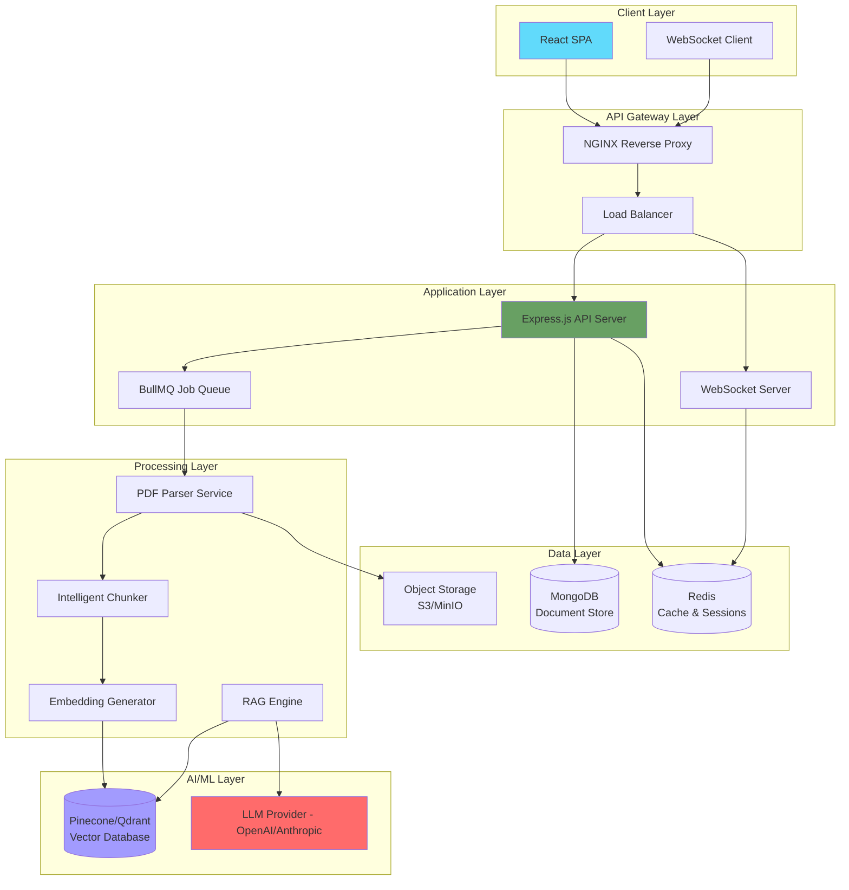
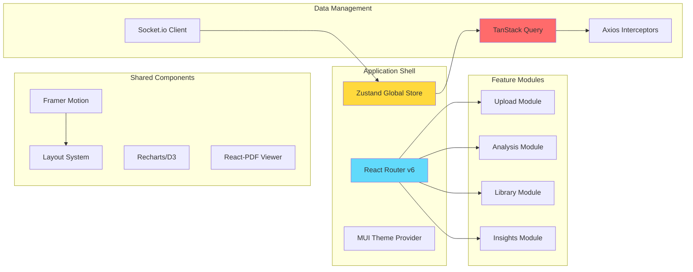
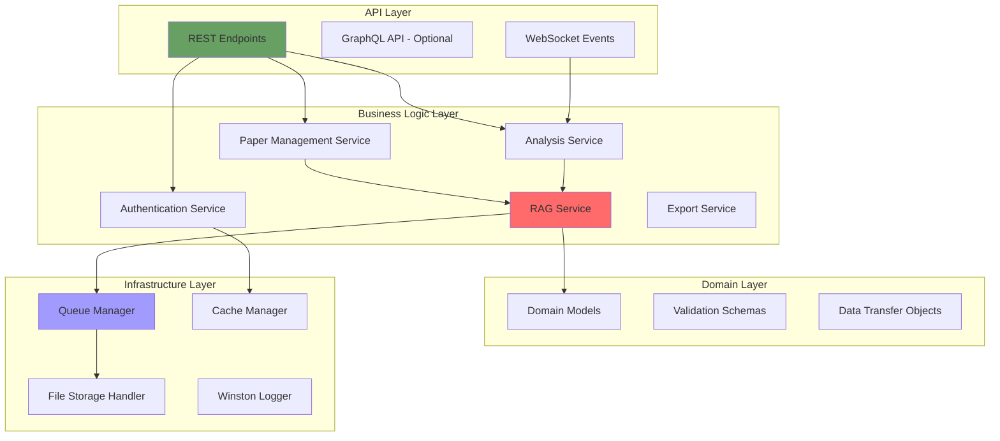
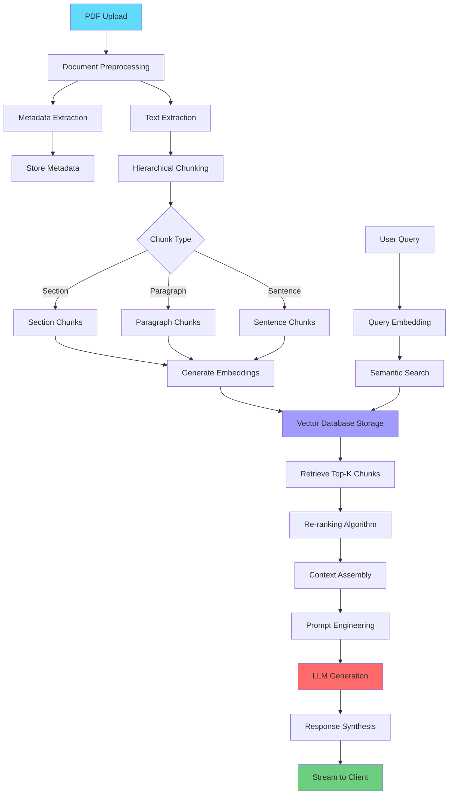
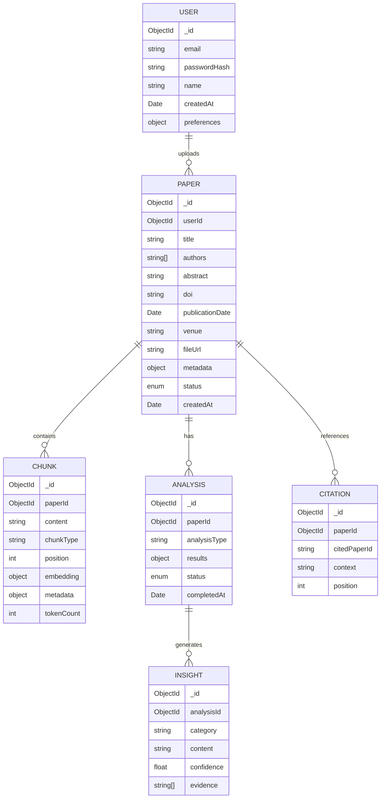
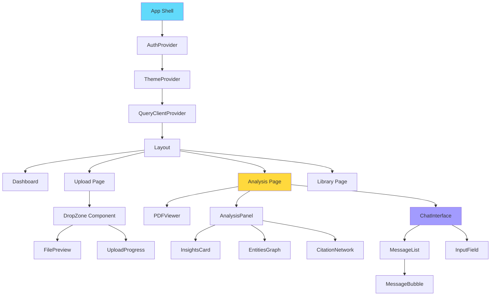
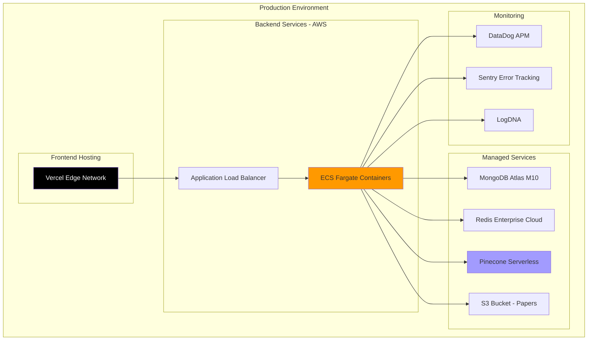

I'll create a comprehensive technical specification for an advanced RAG-powered research paper analysis platform. This will be a production-ready architecture with sophisticated information extraction capabilities.

# Research Paper RAG Analysis Platform - Technical Specification

## Executive Summary

A sophisticated web application leveraging Retrieval-Augmented Generation (RAG) architecture to perform semantic decomposition, entity extraction, and knowledge synthesis from academic research papers. The system employs vector embeddings, hierarchical chunking strategies, and multi-modal extraction pipelines to deliver contextually-enriched insights.

---

## 1. System Architecture Overview



---

## 2. Core System Components

### 2.1 Frontend Architecture (React)



#### 2.1.1 Technology Stack - Frontend

| Category | Technology | Justification |
|----------|-----------|---------------|
| **Framework** | React 18.2+ | Concurrent rendering, Suspense, automatic batching |
| **State Management** | Zustand | Minimal boilerplate, TypeScript-first, performance |
| **Routing** | React Router v6 | Declarative routing, data loading APIs |
| **UI Components** | Material-UI v5 + Tailwind CSS | Comprehensive component library + utility-first styling |
| **Animation** | Framer Motion | Production-ready physics-based animations |
| **Data Fetching** | TanStack Query v5 | Intelligent caching, optimistic updates, background sync |
| **Forms** | React Hook Form + Zod | Performant validation, type-safe schemas |
| **Charts** | Recharts + D3.js | Citation graphs, knowledge networks visualization |
| **PDF Handling** | react-pdf + PDF.js | Client-side rendering, annotation support |
| **Build Tool** | Vite | Lightning-fast HMR, optimized production builds |

---

### 2.2 Backend Architecture (Node.js)



#### 2.2.1 Technology Stack - Backend

| Category | Technology | Justification |
|----------|-----------|---------------|
| **Runtime** | Node.js 20+ LTS | Enhanced performance, native fetch API |
| **Framework** | Express.js 4.x | Mature ecosystem, middleware architecture |
| **Language** | TypeScript 5.x | Type safety, advanced generics, decorators |
| **ORM** | Mongoose 8.x | Schema validation, middleware hooks, virtuals |
| **Queue** | BullMQ | Redis-based, job prioritization, retry strategies |
| **WebSocket** | Socket.io | Real-time bi-directional communication |
| **Validation** | Zod | Runtime type validation, schema inference |
| **Authentication** | Passport.js + JWT | Strategy-based auth, stateless tokens |
| **File Upload** | Multer | Multipart form handling, streaming |
| **PDF Processing** | pdf-parse + pdf.js-extract | Text extraction, metadata parsing |
| **Vector Embeddings** | OpenAI Ada-002 / text-embedding-3-large | State-of-the-art semantic embeddings |
| **LLM Integration** | LangChain.js | Abstraction layer, chain orchestration |

---

## 3. RAG Pipeline Architecture



### 3.1 Chunking Strategy

```javascript
interface ChunkingStrategy {
  type: 'hierarchical' | 'semantic' | 'sliding_window';
  config: {
    maxChunkSize: number;        // 512 tokens
    chunkOverlap: number;         // 50 tokens
    hierarchyLevels: string[];    // ['section', 'paragraph', 'sentence']
    semanticThreshold: number;    // 0.7 for semantic similarity
  };
}
```

**Hierarchical Chunking Levels:**

1. **Document Level**: Complete paper metadata and abstract
2. **Section Level**: Introduction, Methodology, Results, Discussion, Conclusion
3. **Paragraph Level**: Semantic paragraphs within sections
4. **Sentence Level**: Individual sentences for fine-grained retrieval

---

## 4. Database Schema Design

### 4.1 MongoDB Collections



### 4.2 Vector Database Schema (Pinecone)

```typescript
interface VectorMetadata {
  paperId: string;
  chunkId: string;
  chunkType: 'section' | 'paragraph' | 'sentence';
  position: number;
  sectionTitle?: string;
  authors: string[];
  publicationYear: number;
  tokenCount: number;
  textContent: string; // Stored for display
}

interface VectorRecord {
  id: string;              // Unique chunk identifier
  values: number[];        // 1536-dim embedding vector (Ada-002)
  metadata: VectorMetadata;
}
```

---

## 5. API Specification

### 5.1 REST Endpoints

```typescript
// Paper Management
POST   /api/v1/papers/upload          // Multipart upload
GET    /api/v1/papers                 // List with pagination
GET    /api/v1/papers/:id             // Retrieve single paper
DELETE /api/v1/papers/:id             // Delete paper
PATCH  /api/v1/papers/:id             // Update metadata

// Analysis Endpoints
POST   /api/v1/papers/:id/analyze     // Trigger analysis
GET    /api/v1/papers/:id/analysis    // Get analysis results
POST   /api/v1/papers/:id/query       // RAG query endpoint

// Insights
GET    /api/v1/papers/:id/insights    // Extracted insights
GET    /api/v1/papers/:id/entities    // Named entities
GET    /api/v1/papers/:id/citations   // Citation network

// Export
GET    /api/v1/papers/:id/export      // Export formats: PDF, MD, JSON

// User
POST   /api/v1/auth/register
POST   /api/v1/auth/login
POST   /api/v1/auth/refresh
GET    /api/v1/user/profile
```

### 5.2 WebSocket Events

```typescript
// Client -> Server
interface ClientEvents {
  'paper:upload': (file: File) => void;
  'analysis:request': (paperId: string, options: AnalysisOptions) => void;
  'query:send': (paperId: string, query: string) => void;
}

// Server -> Client
interface ServerEvents {
  'upload:progress': (progress: number) => void;
  'processing:status': (status: ProcessingStatus) => void;
  'analysis:chunk': (chunk: AnalysisChunk) => void;
  'analysis:complete': (result: AnalysisResult) => void;
  'query:response': (response: string, chunks: Chunk[]) => void;
  'error': (error: ErrorPayload) => void;
}
```

---

## 6. Frontend Component Architecture



### 6.1 Key Component Specifications

#### 6.1.1 Upload Component with Drag-and-Drop

```typescript
interface UploadZoneProps {
  onUpload: (file: File) => Promise<void>;
  maxSize: number; // 50MB
  acceptedFormats: string[]; // ['.pdf']
  multiple: boolean;
}

// Features:
// - Framer Motion drag animations
// - Real-time upload progress with WebSocket
// - File validation with visual feedback
// - Thumbnail generation for preview
// - Batch upload support
```

#### 6.1.2 Analysis Dashboard

```typescript
interface AnalysisDashboardProps {
  paperId: string;
  analysis: AnalysisResult;
  onQuerySubmit: (query: string) => void;
}

// Sections:
// 1. Paper Overview Card (animated expand/collapse)
// 2. Key Insights Panel (masonry layout)
// 3. Entity Relationship Graph (D3 force-directed)
// 4. Citation Network Visualization
// 5. Interactive Q&A Chat Interface
// 6. Methodology Extraction
// 7. Results Summary
```

#### 6.1.3 RAG Chat Interface

```typescript
interface ChatInterfaceProps {
  paperId: string;
  context: PaperContext;
  streamResponse: boolean; // Enable SSE streaming
}

// Features:
// - Auto-scroll to latest message
// - Typing indicators
// - Source citation badges
// - Message reactions
// - Copy/export conversation
// - Syntax highlighting for code snippets
// - LaTeX equation rendering
```

---

## 7. UI/UX Design System

### 7.1 Animation Specifications

```typescript
// Framer Motion Variants
const pageTransition = {
  initial: { opacity: 0, y: 20 },
  animate: { opacity: 1, y: 0 },
  exit: { opacity: 0, y: -20 },
  transition: { duration: 0.3, ease: 'easeInOut' }
};

const cardHover = {
  rest: { scale: 1, boxShadow: '0 4px 6px rgba(0,0,0,0.1)' },
  hover: { 
    scale: 1.02, 
    boxShadow: '0 10px 20px rgba(0,0,0,0.15)',
    transition: { duration: 0.2 }
  }
};

const progressBarAnimation = {
  initial: { width: 0 },
  animate: { width: '100%' },
  transition: { duration: 1.5, ease: 'easeOut' }
};

const staggerChildren = {
  animate: {
    transition: {
      staggerChildren: 0.1
    }
  }
};
```

### 7.2 Color Palette

```scss
// Primary Colors
$primary-900: #1a1a2e;
$primary-700: #16213e;
$primary-500: #0f3460;
$primary-300: #533483;
$primary-100: #e94560;

// Semantic Colors
$success: #06ffa5;
$warning: #ffd93d;
$error: #ff6b6b;
$info: #4dabf7;

// Neutrals
$gray-900: #1a1a1a;
$gray-700: #4a4a4a;
$gray-500: #9ca3af;
$gray-300: #d1d5db;
$gray-100: #f3f4f6;
```

### 7.3 Typography System

```css
/* Font Families */
--font-primary: 'Inter', -apple-system, BlinkMacSystemFont, sans-serif;
--font-mono: 'JetBrains Mono', 'Fira Code', monospace;
--font-serif: 'Merriweather', Georgia, serif;

/* Type Scale */
--text-xs: 0.75rem;    /* 12px */
--text-sm: 0.875rem;   /* 14px */
--text-base: 1rem;     /* 16px */
--text-lg: 1.125rem;   /* 18px */
--text-xl: 1.25rem;    /* 20px */
--text-2xl: 1.5rem;    /* 24px */
--text-3xl: 1.875rem;  /* 30px */
--text-4xl: 2.25rem;   /* 36px */
```

---

## 8. RAG Implementation Details

### 8.1 Prompt Engineering Templates

```typescript
const ANALYSIS_PROMPTS = {
  keyInsights: `
    Analyze the following research paper chunks and extract the most significant insights.
    
    Focus on:
    1. Novel contributions and innovations
    2. Methodological approaches and their uniqueness
    3. Empirical findings and their implications
    4. Limitations and future research directions
    5. Practical applications
    
    Context: {{chunks}}
    
    Provide insights in structured JSON format with confidence scores.
  `,
  
  methodology: `
    Extract and synthesize the research methodology from the paper.
    
    Identify:
    - Research design and paradigm
    - Data collection methods
    - Analysis techniques
    - Tools and technologies used
    - Sample size and demographics
    - Validation strategies
    
    Context: {{chunks}}
  `,
  
  entityExtraction: `
    Perform Named Entity Recognition on the research paper.
    
    Extract:
    - Technical concepts and terminology
    - Algorithms and models mentioned
    - Datasets and benchmarks
    - Evaluation metrics
    - Related works and citations
    - Organizations and institutions
    
    Context: {{chunks}}
    
    Return as structured entities with relationships.
  `
};
```

### 8.2 Retrieval Strategy

```typescript
interface RetrievalConfig {
  // Hybrid search combining dense and sparse retrieval
  hybridAlpha: number; // 0.7 (70% dense, 30% BM25)
  
  // Re-ranking with cross-encoder
  reranker: {
    model: 'cross-encoder/ms-marco-MiniLM-L-6-v2';
    topK: 20; // Initial retrieval
    finalK: 5; // After re-ranking
  };
  
  // MMR (Maximal Marginal Relevance) for diversity
  mmr: {
    lambda: 0.5; // Balance relevance vs diversity
    enabled: true;
  };
  
  // Contextual compression
  compression: {
    enabled: true;
    ratio: 0.3; // Compress to 30% of original
  };
}
```

### 8.3 Processing Pipeline Workers

```typescript
// BullMQ Job Definitions
enum JobType {
  PDF_PARSE = 'pdf:parse',
  CHUNKING = 'chunking:hierarchical',
  EMBEDDING = 'embedding:generate',
  ANALYSIS = 'analysis:full',
  ENTITY_EXTRACTION = 'entity:extract',
  CITATION_GRAPH = 'citation:build'
}

interface JobData {
  paperId: string;
  userId: string;
  fileUrl: string;
  options: ProcessingOptions;
}

// Worker Configuration
const workerConfig = {
  concurrency: 5,
  limiter: {
    max: 100, // 100 jobs
    duration: 60000 // per minute
  },
  defaultJobOptions: {
    attempts: 3,
    backoff: {
      type: 'exponential',
      delay: 2000
    }
  }
};
```

---

## 9. Security & Performance

### 9.1 Security Measures

```typescript
// Rate Limiting
const rateLimitConfig = {
  windowMs: 15 * 60 * 1000, // 15 minutes
  max: 100, // Limit each IP to 100 requests per window
  standardHeaders: true,
  legacyHeaders: false,
};

// File Upload Security
const uploadSecurity = {
  fileSize: 50 * 1024 * 1024, // 50MB
  allowedMimeTypes: ['application/pdf'],
  virusScan: true, // ClamAV integration
  encryption: {
    algorithm: 'aes-256-gcm',
    atRest: true
  }
};

// Authentication
const jwtConfig = {
  accessTokenExpiry: '15m',
  refreshTokenExpiry: '7d',
  algorithm: 'RS256', // Asymmetric signing
  issuer: 'research-rag-platform'
};
```

### 9.2 Performance Optimizations

```typescript
// Caching Strategy
const cacheConfig = {
  // Redis layers
  layers: {
    embedding: { ttl: 86400 * 30 }, // 30 days
    analysis: { ttl: 86400 * 7 },   // 7 days
    metadata: { ttl: 3600 }          // 1 hour
  },
  
  // CDN for static assets
  cdn: {
    provider: 'CloudFlare',
    purgeOnDeploy: true
  },
  
  // Database indexing
  indexes: [
    { collection: 'papers', fields: { userId: 1, createdAt: -1 } },
    { collection: 'papers', fields: { 'metadata.doi': 1 }, unique: true },
    { collection: 'chunks', fields: { paperId: 1, position: 1 } }
  ]
};

// Frontend optimizations
const frontendOptimizations = {
  codeSpitting: true,
  lazyLoading: true,
  imageOptimization: {
    formats: ['webp', 'avif'],
    responsive: true
  },
  bundleAnalysis: true,
  treeshaking: true
};
```

---

## 10. Deployment Architecture



---

## 11. Development Phases

### Phase 1: Foundation (Weeks 1-2)
- ✅ Project scaffolding and repository setup
- ✅ Authentication system implementation
- ✅ File upload infrastructure
- ✅ Database schema implementation
- ✅ Basic UI component library

### Phase 2: Core RAG Pipeline (Weeks 3-5)
- ✅ PDF parsing and text extraction
- ✅ Hierarchical chunking implementation
- ✅ Embedding generation pipeline
- ✅ Vector database integration
- ✅ Basic retrieval functionality

### Phase 3: Analysis Features (Weeks 6-8)
- ✅ Multi-modal analysis pipelines
- ✅ Entity extraction service
- ✅ Citation network builder
- ✅ Insight generation algorithms
- ✅ Real-time WebSocket integration

### Phase 4: UI/UX Polish (Weeks 9-10)
- ✅ Advanced animations and transitions
- ✅ Interactive visualizations
- ✅ Responsive design refinement
- ✅ Accessibility compliance (WCAG 2.1 AA)
- ✅ Performance optimization

### Phase 5: Production Readiness (Weeks 11-12)
- ✅ Security auditing and penetration testing
- ✅ Load testing and optimization
- ✅ Documentation completion
- ✅ CI/CD pipeline setup
- ✅ Monitoring and alerting configuration

---

## 12. Metrics & Analytics

```typescript
interface AnalyticsEvents {
  // User engagement
  'paper.uploaded': { size: number; format: string };
  'analysis.requested': { paperId: string; type: string };
  'query.submitted': { paperId: string; queryLength: number };
  
  // Performance metrics
  'processing.duration': { stage: string; duration: number };
  'retrieval.latency': { k: number; latency: number };
  'llm.tokens': { prompt: number; completion: number; cost: number };
  
  // Business metrics
  'user.retention': { day: number };
  'feature.usage': { feature: string; frequency: number };
}

// Dashboard KPIs
const kpis = {
  averageProcessingTime: 'Target: <30s for 20-page paper',
  retrievalAccuracy: 'Target: >90% relevant chunks',
  userSatisfaction: 'Target: 4.5+ star rating',
  systemUptime: 'Target: 99.9% availability'
};
```

---

## 13. Future Enhancements

1. **Multi-language Support**: Extend to non-English papers with multilingual embeddings
2. **Collaborative Annotations**: Real-time collaborative paper review
3. **Literature Review Generator**: Automated synthesis of multiple papers
4. **Citation Recommendation**: Suggest relevant papers to cite
5. **Mobile Application**: React Native companion app
6. **API Marketplace**: Public API for third-party integrations
7. **Custom Model Fine-tuning**: Domain-specific language models

---

This specification provides a comprehensive blueprint for building a production-grade RAG application with sophisticated information extraction capabilities, modern UI/UX, and scalable architecture. The system leverages cutting-edge technologies in vector search, language models, and real-time web applications to deliver an exceptional research analysis experience.